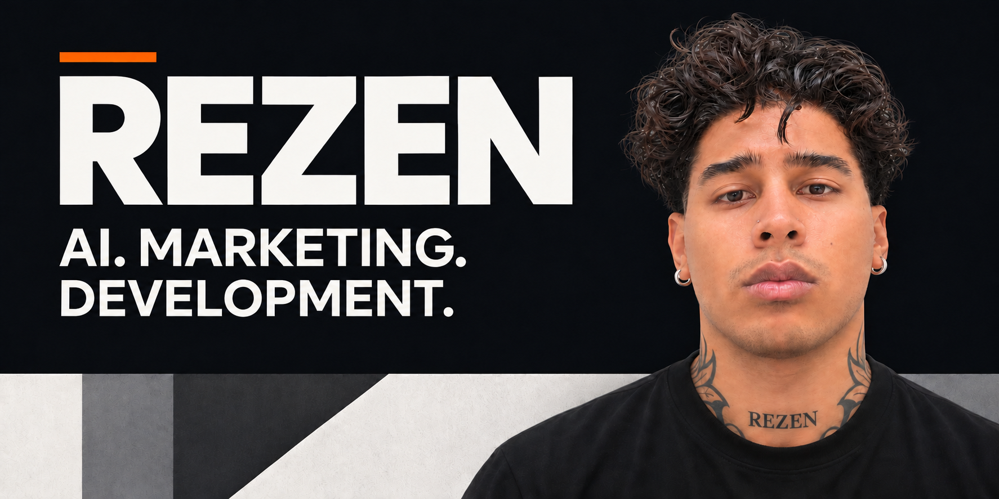

# Jose Stefano Arnone

Lavoro come **Fractional CMTO** in **REZEN**. Aiuto le aziende a far lavorare insieme marketing, sviluppo e AI. Parto dagli obiettivi aziendali e li traduco in priorità, strumenti e processi che il team può usare ogni giorno.

## Cosa costruisco

- **Sviluppo.** Applicazioni web, strumenti interni e infrastrutture per l’AI.
- **Marketing.** Sistemi per collegare acquisizione, misurazione e CRM.
- **AI e automazione.** Integrazioni tra strumenti e applicazioni per cercare nei documenti, preparare report e semplificare attività operative.

Su GitHub voglio condividere esempi riproducibili, strumenti riutilizzabili e appunti su come progetto e verifico queste soluzioni.

[LinkedIn](https://www.linkedin.com/in/josestefanoarnone/)
